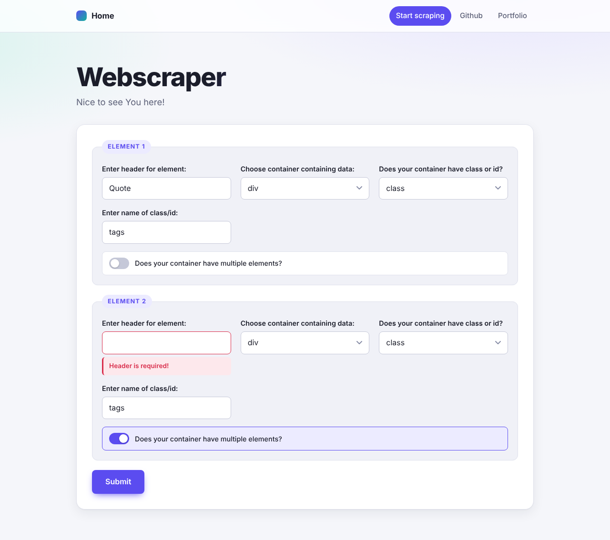
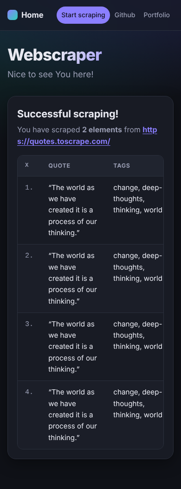

<div align="center">

# 🕸️ Webscraper

**Configurable web scraper with a Flask UI – pick the HTML elements, get a clean table.**


</div>

---

## About

Webscraper is a small web application that lets you scrape data from any page **without writing code**.
You give it a URL, describe which HTML elements hold the data (tag + class or id), and the app
returns the results as a numbered table – one column per element you defined.

Built as a learning project to practise Flask, WTForms, BeautifulSoup and clean, documented Python
(docstrings following PEP 257).

> 🧪 Safe page to test on: <https://quotes.toscrape.com/>

## Features

- 🔧 **Dynamic form** – define from 1 to 20 elements to scrape in a single run
- 🎯 **Flexible selectors** – choose the tag (`div`, `span`, `p`, `small`, `h1`–`h6`) and match it by `class` or `id`
- 🧩 **Nested elements** – toggle *"multiple elements"* to collect the text of every child tag
  and join it into one cell (e.g. `change, deep-thoughts, thinking, world`)
- 📊 **Result table** – results from all elements merged into rows, ready to read
- ✅ **Validation & CSRF protection** – Flask-WTF validates every field and protects the forms
- 📝 **Logging** – rotating log files plus console output
- 🌗 **Responsive UI** – works on desktop and mobile, with automatic dark mode

## Screenshots

| Scraping form | Results (mobile, dark mode) |
| :---: | :---: |
|  |  |

## Tech stack

| Layer | Tools |
| --- | --- |
| Backend | Python 3.15, Flask, Werkzeug |
| Forms | Flask-WTF, WTForms |
| Scraping | Requests, BeautifulSoup 4 (`html.parser`) |
| Frontend | Jinja2 templates, plain CSS |
| Docs | MkDocs |

## Getting started

### Requirements

- Python **3.15+**
- `pip` or [`uv`](https://docs.astral.sh/uv/)

### Installation

```bash
git clone https://github.com/TomRenGamer/webscraper-system.git
cd webscraper-system

python -m venv .venv
# Windows
.venv\Scripts\activate
# Linux / macOS
source .venv/bin/activate

pip install -r requirements.txt
```

Using `uv` instead:

```bash
uv sync
```

### Configuration

The app reads its session key from the `SECRET_KEY` environment variable.
Without it, a random key is generated on every start (fine for local development).

```powershell
# Windows PowerShell
$env:SECRET_KEY = "your-long-random-secret"
```

```bash
# Linux / macOS
export SECRET_KEY="your-long-random-secret"
```

See `.env.example` for reference.

### Run

```bash
cd app
python app.py
```

Open <http://127.0.0.1:4500> in your browser.

## How to use

1. Click **Start scraping**.
2. Enter the **page URL** and the **number of elements** you want to scrape.
3. For every element fill in:
   - **Header** – column name in the result table,
   - **Container** – HTML tag holding the data,
   - **Class or id** and its **name**,
   - **Multiple elements** – turn on if the data sits in child tags of the container.
4. Click **Submit** and see the results.

**Example** on quotes.toscrape.com:

| Header | Container | Selector | Name | Multiple elements |
| --- | --- | --- | --- | :---: |
| Quote | `span` | class | `text` | ⬜ |
| Author | `small` | class | `author` | ⬜ |
| Tags | `div` | class | `tags` | ✅ |

## Project structure

```
webscraper/
├── app/
│   ├── app.py                 # Flask app and routes
│   ├── components/
│   │   ├── __init__.py        # logging setup
│   │   ├── scrapeElement.py   # ScrapeElement – fetching & parsing HTML
│   │   └── csvWriter.py       # CsvWriter – saving data to CSV
│   ├── forms/
│   │   ├── setOptionsForm.py  # URL + number of elements
│   │   └── scrapeDataForm.py  # per-element scraping settings
│   ├── templates/             # Jinja2 templates
│   └── static/style.css
├── documentation/             # MkDocs documentation
├── requirements.txt
└── pyproject.toml
```

## How it works

```
/setOptions  →  /scrapeData  →  ScrapeElement.scrape()  →  extract_text()  →  /result
  URL + count     form per        requests + BeautifulSoup     one string        table
                  element         find_all(tag, class/id)      per cell
```

## Roadmap

- [ ] Export results to CSV (`CsvWriter` is ready, needs a route and a button)
- [ ] Custom CSS selector for nested elements (e.g. `a.tag`)
- [ ] Check `robots.txt` before scraping
- [ ] Documentation site with MkDocs
- [ ] Tests for scraping logic

## Responsible scraping

Scrape only pages you are allowed to, respect `robots.txt` and the site's terms of use,
and don't overload servers with requests.

## Author

**TomRen** – [devren.pl](https://devren.pl)
